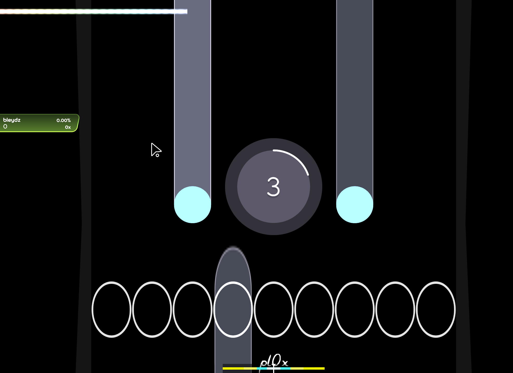
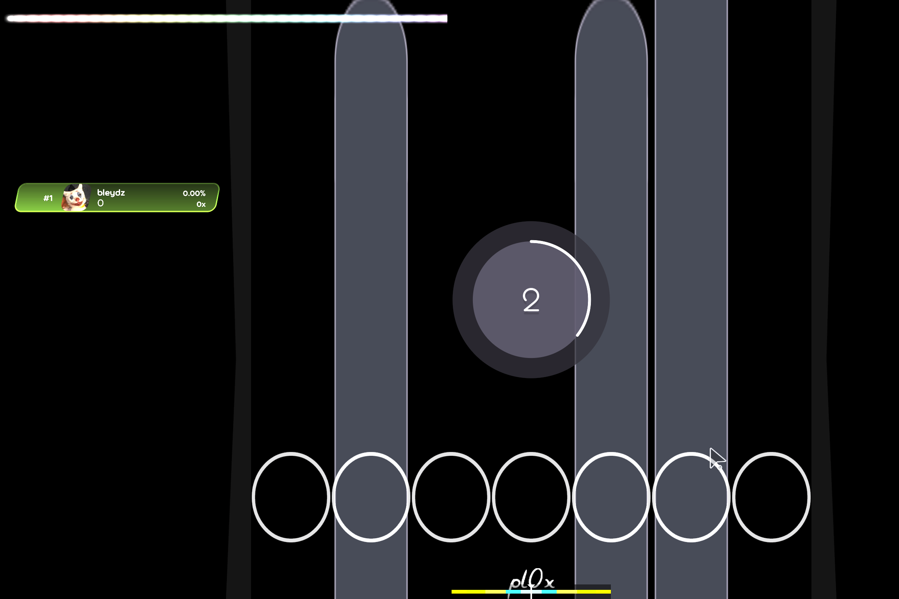
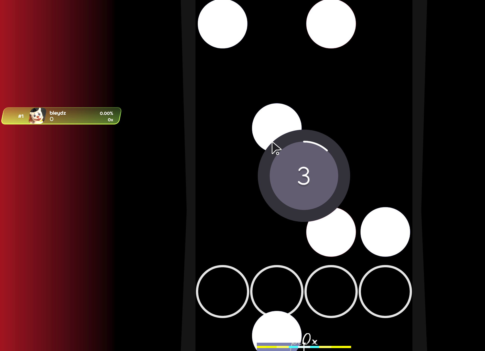
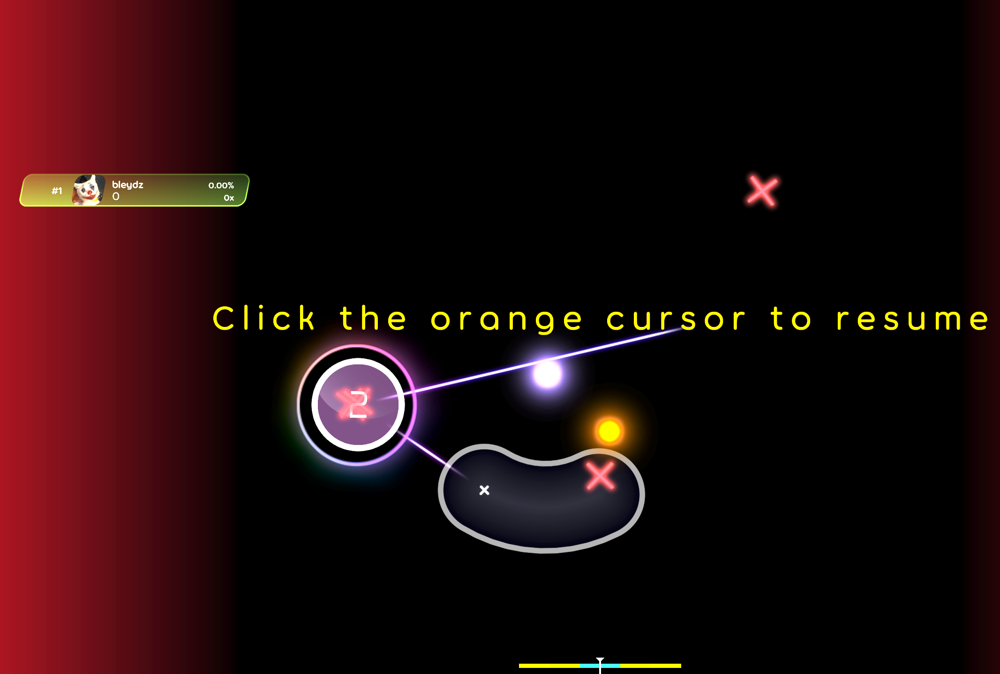

# [dave] — osu! dual-mode skins

Skins that cover **osu!standard** and **osu!mania** in one, so there's no need to switch skins between modes.
Both use the same mania setup; they differ only in standard and the UI.

| Skin | Standard + UI | Download |
|---|---|---|
| **[dave]** | Selyu v2.2 | [[dave].osk](./%5Bdave%5D.osk?raw=1) |
| **[dave] Aristia** | Aristia Edit (Varvalian 2019-06-25) | [[dave] Aristia.osk](./%5Bdave%5D%20Aristia.osk?raw=1) |

> [!NOTE]
> **[dave] Aristia:** the framed box around the playfield is hidden in mania **on osu!lazer only**. It uses a lazer-only gameplay layout, so on osu!stable the box still shows in mania.

---

## [dave]

- **Standard + all UI:** Selyu v2.2, unchanged
- **Mania 4K / 5K / 6K:** JOSHUA0309 skin edit (prank855, Myuka - IceTea Edits), unchanged
- **Mania 7K + 9K:** new layouts built from the JOSHUA 4K notes, receptors and stage

Works in osu!stable and osu!lazer.

Download a `.osk` from the table above and double-click it to import into osu!.

## Screenshots

### Mania 9K

### Mania 7K

### Mania 4K

### Standard

## [dave] Aristia

Same mania as **[dave]** (4K/5K/6K from JOSHUA0309, plus the 7K and 9K layouts), with standard and the UI from
**Aristia Edit [Varvalian 2019-06-25]** in place of Selyu. The Aristia skin is unchanged; source: [osuskins.net/skin/vjUqKOh](https://osuskins.net/skin/vjUqKOh).

Aristia ships its own mania judgement images, so JOSHUA's are kept in `mania/judgements/` to keep the mania look identical.

**Lazer only:** this version was exported from osu!lazer with a custom gameplay layout that hides Aristia's framed health-bar box in mania. osu!stable ignores that layout, so stable players will still see the box in mania.

## Notes

- Some elements are shared across all modes and come from the standard skin (Selyu or Aristia): score/combo numbers, health bar, results screen, menus and hitsounds.
- JOSHUA's original 7K layout (bar-style notes) is still in `skin.ini`, commented out. Uncomment it and comment out the new 7K block to switch back.

## Credits

This is a mixed skin. All original artwork belongs to its creators:

- **Selyu** — *Selyu v2.2* (standard, UI, cursors). The original skin itself credits elements and cursors from other skins.
- **Garin** — *Aristia Edit* as played by Varvalian (2019-06-25), built on *Aristia* with elements from various skins ([osuskins.net](https://osuskins.net/skin/vjUqKOh))
- **prank855** and **Myuka - IceTea Edits** — original mania skin
- **JOSHUA0309** — mania skin edit (4K/5K/6K layouts, notes, judgements)
- **ppy / osu!** — the rainbow MAX "300" mania judgement in [dave] Aristia, from [osu-resources](https://github.com/ppy/osu-resources) (CC BY-NC 4.0)
- **[bleydz](https://github.com/bleydz)** — combining the skins and the 7K / 9K layouts

If you're one of the original authors and want something credited differently or removed, open an issue.
